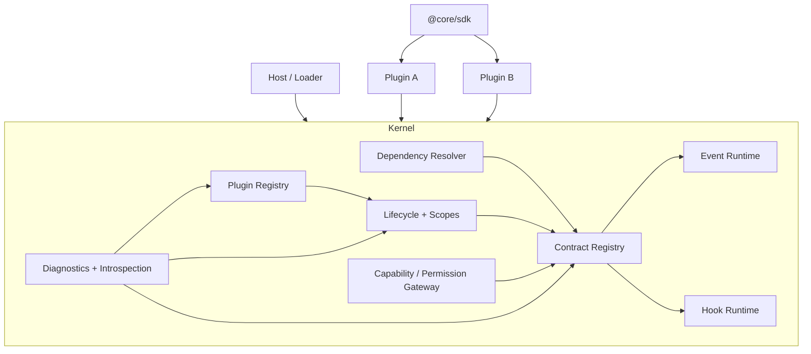
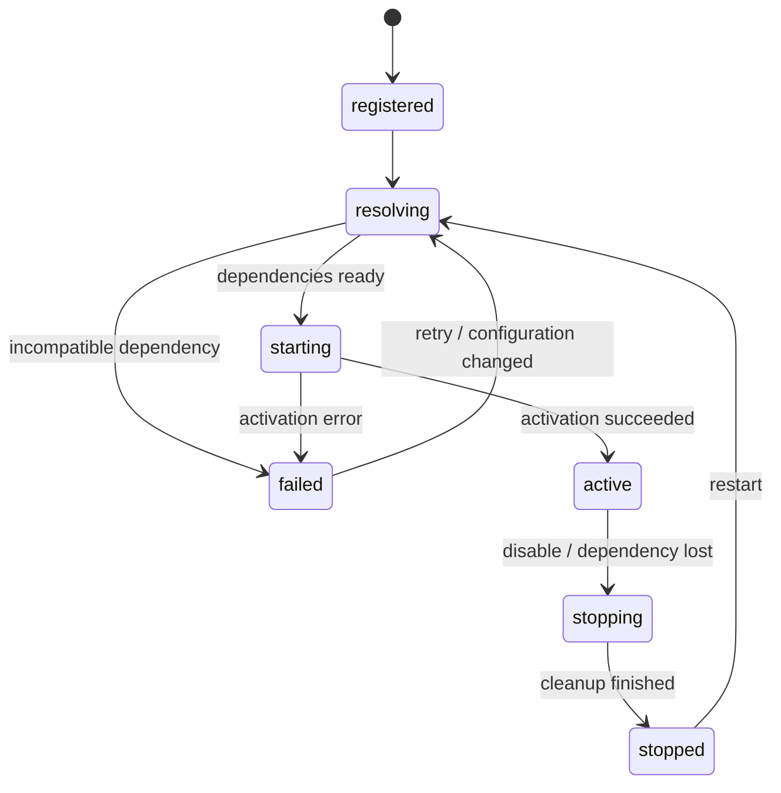

# Проект ядра расширяемой системы: архитектура с низким порогом входа для разработчиков плагинов

## Исполнительное резюме

Исходный документ правильно задаёт фундаментальную границу будущего ядра: оно должно быть не «основой редактора», а компактной средой исполнения и композиции плагинов, отвечающей за lifecycle, contracts, dependency resolution, события, hooks, ownership ресурсов и диагностику. В документе также последовательно проводится идея, что файловая система, UI, Markdown, Tauri, сеть, хранилище и другие прикладные возможности должны находиться за пределами ядра. fileciteturn0file0 Эта граница заслуживает сохранения.

Однако для реальной экосистемы плагинов одной архитектурной чистоты недостаточно. Успешные платформы расширений снижают порог входа тем, что превращают архитектурные решения в **предсказуемый developer journey**: единый manifest, минимальный шаблон плагина, декларативные capabilities, стабильный SDK, понятный lifecycle, автоматическое управление cleanup, локальный sandbox, CLI, типизированные контракты, совместимость по версиям и автоматизированную проверку до публикации. Именно такой путь прослеживается в Chrome Extensions, VS Code и WordPress, хотя конкретные механизмы у них различаются. Chrome делает manifest центральной декларацией extension metadata и permissions; VS Code объединяет manifest, contribution points, activation model, API и disposable lifecycle; WordPress удерживает очень простой стартовый путь, а усложнение вводит постепенно через hooks, handbook, security guidance и review process. citeturn530965search0turn530965search7turn530965search9

Поэтому главное изменение относительно исходного документа — **проектировать ядро одновременно с SDK, manifest schema, CLI, test harness и permission model**, а не считать их последующим слоем. Если эти элементы появятся после runtime, разработчикам придётся изучать внутреннюю модель ядра, чтобы написать первый плагин. Это создаст тот самый высокий порог входа, который необходимо устранить.

Рекомендуемая целевая модель:

| Область | Рекомендация |
|---|---|
| Базовая архитектура | Малое ядро + публичный SDK + host/loader вне ядра |
| Первый плагин | Один manifest, один entry point, одна команда CLI |
| Контракты | Typed contract tokens: API, Event, Hook |
| Lifecycle | Автоматические scopes, cancellation и cleanup |
| Зависимости | Только capability/contract dependencies, не зависимости от конкретных плагинов |
| Безопасность | Capability-based permissions, deny-by-default для чувствительных возможностей |
| Тестирование | In-memory kernel + deterministic plugin test host + sandbox profiles |
| Совместимость | SemVer ядра/SDK + version ranges для contracts + compatibility matrix |
| Публикация | Автоматическая проверка → security checks → review по уровню риска |
| Экосистема | Официальные templates, cookbook, starter plugins, стабильный certification path |
| Главная метрика | Время от пустого каталога до работающего плагина ≤ 10 минут |

Критически важно учитывать, что ядро **ещё не создано**. Поэтому сейчас проще и дешевле сделать developer experience архитектурным инвариантом, чем впоследствии исправлять неудобную API surface. SemVer прямо связывает осмысленное версионирование с наличием чётко определённого public API; пока public API не стабилизирован, версия `0.x` естественно сигнализирует о возможных несовместимых изменениях. citeturn164695search3

## Барьеры входа и целевая модель разработчика

У плагинной платформы есть семь основных классов барьеров. Они взаимосвязаны: технически хорошая архитектура может оставаться трудной для разработчика, если отсутствуют CLI, примеры и диагностические сообщения; наоборот, привлекательный template не спасёт систему с нестабильным lifecycle или неясной permission model.

| Категория | Типичный барьер | Что должно сделать ядро/экосистема |
|---|---|---|
| Технический | Нужно понять registry, lifecycle, dependency graph и ownership | Скрыть mechanics за `definePlugin()` и scoped SDK |
| Организационный | Непонятно, кто принимает изменения API и как получить помощь | Публичные RFC, CONTRIBUTING, SLA ревью, compatibility policy |
| Документационный | Нет пути «hello world → production plugin» | Quickstart, concept guides, recipes, API reference |
| UX разработчика | Много ручной конфигурации, слабые ошибки | CLI, validation, dev server, hot reload, inspect |
| Безопасность | Неясно, какие доступы разрешены | Manifest permissions + runtime capabilities |
| Тестирование | Тесты требуют полноценного приложения | In-memory test host и sandbox fixtures |
| Экосистема | Нет шаблонов, discoverability и доверия | Registry/catalog, certification badges, compatibility metadata |

VS Code — полезный ориентир именно потому, что разработчик видит сравнительно компактную модель: extension manifest, activation, contribution points и Extension API. Отдельные API регистрации возвращают disposables, которые складываются в lifecycle context, что уменьшает вероятность утечек ресурсов. citeturn530965search7 Chrome аналогично делает manifest центральным местом metadata, permission declarations и runtime entry points. citeturn530965search0turn530965search4 WordPress снижает первоначальный порог ещё сильнее: минимальный plugin может состоять буквально из одного файла, а hooks становятся следующим уровнем сложности. citeturn986027search4turn530965search10

Для будущего ядра следует принять принцип **progressive disclosure**: минимальный plugin не должен знать почти ничего о runtime. Расширенные возможности — contracts, hooks, permissions, child scopes, compatibility — появляются только по мере необходимости.

Минимальный developer journey должен выглядеть так:

```text
core create-plugin hello-world
        ↓
готовый проект + manifest + test
        ↓
core dev
        ↓
plugin загружен в test host
        ↓
core test
        ↓
core validate
        ↓
core pack / publish
```

Целевой минимальный плагин:

```ts
import { definePlugin } from "@core/sdk";

export default definePlugin({
  id: "acme.hello-world",

  activate(ctx) {
    ctx.log.info("Plugin activated");

    ctx.commands.register("hello.say", async () => {
      return "Hello";
    });
  }
});
```

Разработчик не должен вручную создавать registry entries, scopes, cancellation controllers или cleanup arrays. Всё зарегистрированное через `ctx.*` автоматически принадлежит scope плагина и уничтожается ядром при deactivation.

Manifest должен быть коротким и декларативным:

```json
{
  "schema": "https://example.org/plugin-manifest.schema.json",
  "id": "acme.hello-world",
  "version": "1.0.0",
  "engine": "^1.2.0",
  "entry": "./dist/plugin.js",
  "permissions": [],
  "requires": {},
  "optionalRequires": {}
}
```

Chrome показывает ценность явного разделения обязательных и optional permissions: optional permissions могут запрашиваться позднее, когда пользователь действительно использует функцию, что уменьшает избыточный доступ и делает запрос понятнее. citeturn530965search1 Аналогичный принцип следует встроить в ядро с самого начала.

## Архитектура ядра, контракты и интерфейсы

Исходный документ убедительно предлагает строить runtime вокруг ownership и contracts, а не вокруг постепенно разрастающегося `AppContext`. fileciteturn0file0 Это следует сохранить, но API сделать заметно проще для обычного plugin developer.

Логическая архитектура:



### Архитектурные принципы

Первый принцип — **ядро знает capabilities, но не прикладные сущности**. Оно не должно знать «документ», «файл», «окно» или «редактор». Конкретные capability contracts принадлежат ecosystem packages.

Второй — **никаких глобальных registries для plugin code**. Каждая регистрация выполняется через lifecycle scope:

```ts
ctx.events.on(UserLoggedIn, listener);
ctx.hooks.register(FormatDocument, handler);
ctx.provide(SearchApi, implementation);
```

Все три автоматически возвращают или внутренне создают disposable resource.

Третий — **API, Events и Hooks остаются разными понятиями**. Такое разделение согласуется с хорошо зарекомендовавшей себя моделью WordPress, где actions предназначены для выполнения действий, а filters — для последовательного преобразования значения. citeturn530965search10 В предлагаемом ядре различие должно быть ещё строже.

| Примитив | Семантика | Возвращает значение | Модификация данных | Multiplicity |
|---|---|---:|---:|---:|
| API | запрос capability | да | возможно | 1 или N provider |
| Event | факт уже произошёл | нет | нет | N listeners |
| Hook | extension point pipeline | да | да | N ordered handlers |

Typed token API:

```ts
export interface Formatter {
  format(input: string): Promise<string>;
}

export const FormatterApi = defineApi<Formatter>({
  id: "core.formatter",
  version: "1.0"
});
```

Provider:

```ts
export default definePlugin({
  id: "acme.formatter",
  activate(ctx) {
    ctx.provide(FormatterApi, {
      async format(input) {
        return input.trim();
      }
    });
  }
});
```

Consumer:

```ts
export default definePlugin({
  id: "acme.consumer",

  requires: {
    formatter: requireApi(FormatterApi, "^1.0")
  },

  async activate(ctx) {
    const result = await ctx.requires.formatter.format(" text ");
    ctx.log.info(result);
  }
});
```

Это лучше, чем зависимость вида `requiresPlugin: "acme.formatter"`, поскольку consumer зависит от интерфейса, а не от конкретной реализации. Такой подход также облегчает testing и alternate providers.

### Lifecycle

Рекомендуемая state machine:



Активация должна быть транзакционной: если plugin зарегистрировал несколько ресурсов, а затем упал, ядро полностью откатывает scope. Такой автоматический rollback — значительно лучший DX, чем требование к каждому разработчику самостоятельно обрабатывать частичную инициализацию.

Cancellation выдаётся через стандартный `AbortSignal`:

```ts
export async function activate(ctx: PluginContext) {
  await connect({
    signal: ctx.signal
  });
}
```

На `stop` ядро сначала отменяет `ctx.signal`, затем выполняет cleanup в обратном порядке.

### Hooks

Hook должен быть объявленным контрактом:

```ts
export const BeforeSave = defineHook<
  SaveRequest,
  SaveRequest
>({
  id: "core.beforeSave",
  version: "1.0",
  mode: "waterfall"
});
```

Использование:

```ts
ctx.hooks.register(
  BeforeSave,
  async request => ({
    ...request,
    text: normalize(request.text)
  }),
  { priority: 100 }
);
```

Порядок должен быть детерминирован. Простого numeric priority достаточно в v1; `before`/`after` можно добавить позднее. Чем меньше ordering semantics в первой версии, тем ниже когнитивная сложность.

## SDK, CLI, документация и тестовая среда

Developer experience следует считать полноценной частью продукта. VS Code предоставляет отдельные guides по anatomy, testing, publishing и CI, а также утилиты для запуска extension tests в настоящем runtime. citeturn530965search7turn986027search1turn986027search27 WordPress поддерживает Handbook, publishing guidance, readme validation и documented review expectations. citeturn530965search9turn986027search36 Open Source Guides подчёркивает, что запутанная документация становится прямым барьером для участия, а публичные правила contribution/review уменьшают трение для новых участников. citeturn530965search12turn164695search5

SDK следует разделить на три уровня:

```text
@core/sdk
  ├─ plugin primitives
  ├─ contract primitives
  ├─ lifecycle utilities
  ├─ diagnostics
  └─ test helpers

@core/contracts-*
  └─ отдельные capability contracts

@core/test
  ├─ createTestKernel()
  ├─ createMockCapability()
  ├─ assertPluginActive()
  └─ simulatePermission()
```

CLI:

```bash
core create-plugin my-plugin
core dev
core test
core validate
core inspect
core pack
core publish
```

`core validate` должен выполнять локально практически те же проверки, что и registry CI. Это критически снижает неприятный цикл «загрузил → получил отказ → исправил → загрузил снова».

Рекомендуемая структура документации:

```text
/docs
  quickstart/
    first-plugin
    first-api
    first-event
    first-hook

  concepts/
    lifecycle
    contracts
    permissions
    compatibility
    sandbox

  guides/
    testing
    debugging
    migration
    publishing
    security

  recipes/
    optional-capability
    async-task
    cleanup
    multi-provider
    hook-ordering

  reference/
    manifest
    sdk
    cli
    errors

  governance/
    api-stability
    plugin-review
    security-policy
```

У каждого concept page должны быть три части: «зачем», «минимальный пример», «когда не использовать». Reference без концептуального объяснения плохо помогает новичкам, а tutorial-only документация плохо помогает опытным разработчикам.

### Test host

Главный инструмент снижения порога — возможность тестировать plugin без запуска полного продукта.

```ts
import {
  createTestKernel,
  installPlugin
} from "@core/test";

test("activates with formatter capability", async () => {
  const kernel = createTestKernel();

  kernel.provide(FormatterApi, {
    format: async text => text.toUpperCase()
  });

  const plugin = await installPlugin(kernel, MyPlugin);

  expect(plugin.state).toBe("active");
});
```

Integration environment:

```bash
core test --profile minimal
core test --profile restricted
core test --profile full
core test --kernel 1.5
core test --kernel next
```

VS Code уже рекомендует отдельно тестировать trusted и untrusted workspace configurations, что показывает ценность заранее определённых security profiles вместо ручной подготовки окружения. citeturn986027search1turn986027search28

Для sandbox необходимо иметь два режима: `logical sandbox` в первой версии и `process/isolate sandbox` в последующих. Logical sandbox означает, что plugin получает только capability APIs, а не host internals. Он не является полноценной security boundary, но заставляет экосистему сразу использовать правильную модель API. Настоящая изоляция может позже использовать worker/process/WASM-механизмы без изменения plugin contract.

## Безопасность, permissions и сертификация

Безопасность нельзя добавлять после стабилизации API: именно публичная поверхность определяет, что вообще возможно ограничить. Chrome демонстрирует зрелую capability-style модель через declared, optional и host permissions; документация прямо рекомендует запрашивать только необходимые разрешения. citeturn530965search1 Chrome Manifest V3 также ограничивает remotely hosted code, поскольку возможность выполнять непроверенный удалённый код резко усложняет модель доверия. citeturn986027search33turn986027search34

Manifest permissions:

```json
{
  "permissions": [
    "storage.read"
  ],
  "optionalPermissions": [
    "network:https://api.example.com",
    "clipboard.write"
  ]
}
```

Базовые правила:

1. Permission model — deny-by-default для чувствительных возможностей.
2. Plugin не получает прямой доступ к host internals.
3. Каждая privileged operation проходит через capability gateway.
4. Permissions granular, а не `system.*`.
5. Optional permissions выдаются непосредственно перед использованием.
6. Решение пользователя можно отозвать.
7. Permission changes между версиями должны быть видимы до обновления.

Runtime:

```ts
const clipboard =
  await ctx.permissions.request(ClipboardWrite);

await clipboard.write("text");
```

Не следует давать:

```ts
ctx.host.rawTauriApi
ctx.host.nodeFs
ctx.host.process
```

иначе permission layer становится декларативным украшением.

Security checks pipeline:

```mermaid
flowchart LR
    Commit["Plugin source"]
    Build["Build"]
    Static["Static checks"]
    Manifest["Manifest validation"]
    Perm["Permission analysis"]
    Tests["Compatibility tests"]
    Sandbox["Sandbox execution"]
    Review["Risk-based review"]
    Registry["Registry"]

    Commit --> Build
    Build --> Static
    Static --> Manifest
    Manifest --> Perm
    Perm --> Tests
    Tests --> Sandbox
    Sandbox --> Review
    Review --> Registry
```



Автоматические проверки должны включать schema validation, package integrity, запрещённые imports, dependency audit, permissions consistency, contract compatibility, lifecycle cleanup, resource leaks, forbidden dynamic execution и basic malicious-pattern detection. WordPress в 2026 году сообщает, что каждый новый релиз плагина перед распространением через update API проходит automated security review; это хороший ориентир для направления развития registry pipeline. citeturn986027search15 WordPress Directory также применяет формальный набор plugin guidelines и может закрывать plugins при security violations. citeturn986027search0

При этом review должен быть risk-based, иначе он сам станет барьером входа:

| Риск | Пример | Процесс |
|---|---|---|
| Низкий | без permissions, pure hooks/API | полностью автоматическая публикация |
| Средний | storage, network к фиксированным hosts | автоматические проверки + выборочный review |
| Высокий | filesystem write, process execution, native bridge | обязательный human security review |
| Критический | новые privileged capabilities | review архитектуры + approval maintainers |

Certificate badge не должен означать «plugin безопасен вообще». Лучше использовать конкретные признаки: `Automated checks passed`, `Reviewed permissions`, `Verified publisher`, `Compatible with kernel 1.x`.

## Версионирование, совместимость и эволюция API

Следует разделить как минимум четыре версии:

```text
Plugin package version
Kernel runtime version
SDK version
Contract version
```

Их нельзя связывать одной цифрой.

Manifest:

```json
{
  "version": "2.3.1",
  "engine": ">=1.4 <2",
  "sdk": "^1.6.0",
  "requires": {
    "core.formatter": "^1.0",
    "core.storage": ">=2.1 <3"
  }
}
```

SemVer следует применять к публичным контрактам: incompatible changes повышают MAJOR, backward-compatible additions — MINOR, исправления без изменения API — PATCH. citeturn164695search3 VS Code использует `engines.vscode` для объявления совместимости расширения с API/runtime версии VS Code, что является хорошей моделью для поля `engine`. citeturn530965search6turn530965search7

Совместимость нужно оценивать не только бинарно как «собирается/не собирается». Microsoft в своей классификации API compatibility отдельно рассматривает behavioral, binary, source, design-time, backward и forward compatibility; для TypeScript plugin ecosystem наиболее важны source, runtime behavioral и backward compatibility. citeturn164695search1turn164695search2

Рекомендуемая политика:

| Изменение | Разрешено в minor? | Требование |
|---|---:|---|
| Новый optional SDK method | да | default behavior сохранён |
| Новый Event/Hook | да | не меняет существующий flow |
| Новое optional поле manifest | да | default определён |
| Обязательное поле manifest | нет | major |
| Удаление API | нет | deprecation → major |
| Изменение return semantics | обычно нет | major |
| Добавление permission к existing API | потенциально breaking | migration + major либо compatibility adapter |
| Смена lifecycle ordering | breaking behavioral | major |

Deprecated API должен жить минимум один major cycle:

```ts
/** @deprecated Use ctx.storage.open() */
ctx.store.open();
```

CLI должен помогать:

```bash
core migrate --from 1 --to 2
```

Для контрактов полезен compatibility adapter:

```ts
registerAdapter(
  FormatterV1,
  FormatterV2,
  v1 => ({
    format: async (text, options) =>
      v1.format(text)
  })
);
```

Однако adapters должны быть исключением, а не основным механизмом. Чем дольше ядро поддерживает скрытые compatibility layers, тем тяжелее оно становится.

## План создания ядра и критерии готовности

Поскольку ядро отсутствует, миграционный план следует понимать как переход **от архитектурного документа к рабочей платформе**, а не как миграцию существующей реализации. Главная ошибка на этом этапе — реализовать весь runtime, а затем начать проверять, удобно ли писать plugins. Developer journey нужно проверять на каждом этапе.

| Этап | Результат | Критерии готовности | Метрики |
|---|---|---|---|
| Contract design | RFC ядра, manifest, SDK draft | 3 независимых plugin scenarios реализуемы только публичным API | ≤10 публичных core concepts |
| Minimal runtime | registry, lifecycle, scopes | activate/deactivate/rollback детерминированы | 100% lifecycle tests |
| Contracts | API/Event/Hook runtime | typed examples без internal imports | first plugin <30 LOC |
| SDK + CLI | create/dev/test/validate | новый developer запускает example без чтения internals | time-to-first-plugin ≤10 мин |
| Permissions | capability gateway | privileged access невозможен в обход SDK | 100% privileged APIs mapped |
| Test platform | in-memory host + profiles | plugin CI не требует приложения | tests start <5 сек |
| Compatibility | SemVer/ranges/deprecation tools | N-1 plugins проходят на N | ≥95% compatibility suite |
| Registry beta | validation + review | automated publication low-risk plugins | automated rejection precision >95% |
| Stable 1.0 | public stability policy | no known blockers для external ecosystem | API churn <5% за 6 мес |

До реализации полноценного ядра полезно провести **API prototyping without implementation**: написать 5–10 примерных plugins только против типов SDK. Если API выглядит сложным даже в фиктивном example, runtime его не исправит.

Первый набор reference plugins должен проверять разные сценарии:

```text
hello-world
api-provider
api-consumer
event-listener
hook-transformer
optional-capability
permission-request
failing-activation
dependency-loss
sandboxed-plugin
```

Эти examples должны стать одновременно документацией, fixtures и compatibility tests.

Критерий `1.0` следует определять не числом реализованных функций, а стабильностью developer contract. SemVer прямо указывает, что `1.0.0` означает определение публичного API; до этого `0.y.z` подразумевает нестабильность. citeturn164695search3

Итоговая рекомендация — сохранить микроядерную философию исходного документа, но изменить точку проектирования: **ядро следует проектировать не изнутри runtime, а от опыта автора плагина внутрь runtime**. Разработчик должен видеть один manifest, один SDK, один context и несколько чётко различимых primitives. Registry, graph algorithms, rollback, ownership, cancellation, permission enforcement и diagnostics должны оставаться скрытой сложностью платформы. Именно это даст будущему ядру одновременно архитектурную строгость и низкий порог входа.